<div align="center">

<!-- HACKER CIPHER DECRYPTION HEADER -->
<picture>
  <source media="(prefers-color-scheme: dark)"  srcset="assets/header-cipher-dark.svg">
  <source media="(prefers-color-scheme: light)" srcset="assets/header-cipher-light.svg">
  
</picture>

<br>

<!-- NAME / TAGLINE - animated typing banner -->
<a href="https://github.com/iamjaved026">
  
</a>

<br>

<!-- BADGES & SOCIALS -->
<a href="https://iamjaved.site"></a>
<a href="https://github.com/iamjaved026"></a>
<a href="mailto:jvdhussain2008@gmail.com"></a>
<a href="https://github.com/iamjaved026?tab=repositories"></a>

<br><br>


</div>

---

## `~/` whoami

```console
$ cat javed.json | jq .
```

```json
{
  "name": "Javed Hussain",
  "handle": "iamjaved026",
  "location": "Bihar, India",
  "role": "Security Researcher · Full-Stack Systems Engineer · IoT & AI Builder",
  "motto": "Breaking systems to understand them • Building tools to secure them",
  "current_explorations": [
    "Offensive Web & Database Pentesting (RTDB-Inspector, KofiType audit)",
    "Real-time encrypted terminal communication (aero-chat-cli)",
    "Client-side Biometric Computer Vision via WebAssembly (trueface)",
    "Hardware bus probing & reverse engineering (ESP32 & Jio STB UART)"
  ]
}
```

- 🔐 **Offensive Security & Pentesting**: Passionate about vulnerability research, client-side cryptographic forge analysis, auth bypasses, and database auditing.
- ⚡ **Real-Time & Low-Latency Systems**: Crafting CLI tools, WebSockets, and terminal protocols designed for privacy and speed.
- 🤖 **Embedded IoT & Hardware Research**: Exploring ESP32 microcontrollers, UART bus inspection, home automation, and perimeter laser security.
- 👁️ **Biometric AI & Machine Learning**: Building instant browser-based face recognition pipelines powered by FastAPI, FaceNet, and WebAssembly.

<br>

<div align="center">

## `~/` toolbox

<!-- SEGMENTED TECH STACK -->
<p>
  <br>
  <br>
  <br>
  
</p>

<p>
  
  
  
  
  
  
  
</p>

</div>

---

<div align="center">

## `~/` skill radar

<table>
<tr>
<td width="50%" align="center" valign="middle">

<!-- Hand-authored domain radar - regenerated by GitHub Actions from assets/skills.json -->
<picture>
  <source media="(prefers-color-scheme: dark)" srcset="assets/radar-dark.svg">
  <source media="(prefers-color-scheme: light)" srcset="assets/radar-light.svg">
  
</picture>

</td>
<td width="50%" align="center" valign="middle">

<!-- Live language radar compiled from real repository byte counts -->
<picture>
  <source media="(prefers-color-scheme: dark)" srcset="assets/radar-langs-dark.svg">
  <source media="(prefers-color-scheme: light)" srcset="assets/radar-langs-light.svg">
  
</picture>

</td>
</tr>
</table>

</div>

---

<div align="center">

## `~/` contribution calendar

<!-- 3D isometric calendar, regenerated automatically by .github/workflows/metrics.yml -->
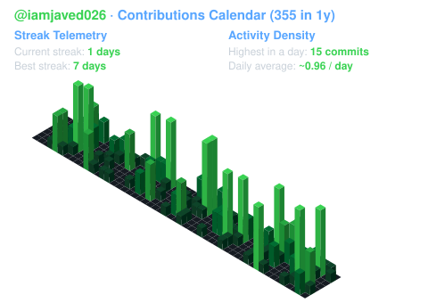

<br><br>

<!-- Snake eats the contribution graph - .github/workflows/snake.yml -->
<picture>
  <source media="(prefers-color-scheme: dark)"  srcset="assets/snake-dark.svg">
  <source media="(prefers-color-scheme: light)" srcset="assets/snake.svg">
  
</picture>

</div>

---

<div align="center">

## `~/` the numbers

<!-- Self-hosted stat telemetry card - Deliberately rendered as SVG inside this repo to eliminate 503 / 402 downtime -->
<picture>
  <source media="(prefers-color-scheme: dark)" srcset="assets/card-stats-dark.svg">
  <source media="(prefers-color-scheme: light)" srcset="assets/card-stats-light.svg">
  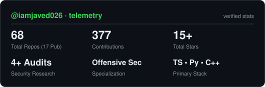
</picture>

<br>

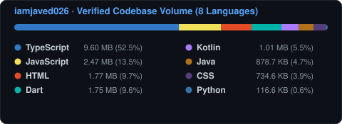

<br><br>

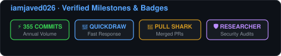

</div>

---

<div align="center">

## `~/` selected work

<!-- Featured Repo Cards rendered by scripts/cards.py from assets/projects.json -->
<table>
<tr>
<td width="50%">
  <a href="https://github.com/iamjaved026/aero-chat-cli">
    <picture>
      <source media="(prefers-color-scheme: dark)" srcset="assets/card-aero-chat-cli-dark.svg">
      <source media="(prefers-color-scheme: light)" srcset="assets/card-aero-chat-cli-light.svg">
      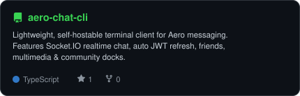
    </picture>
  </a>
</td>
<td width="50%">
  <a href="https://github.com/iamjaved026/RTDB-Inspector">
    <picture>
      <source media="(prefers-color-scheme: dark)" srcset="assets/card-RTDB-Inspector-dark.svg">
      <source media="(prefers-color-scheme: light)" srcset="assets/card-RTDB-Inspector-light.svg">
      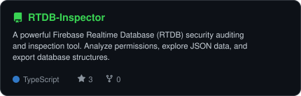
    </picture>
  </a>
</td>
</tr>
<tr>
<td width="50%">
  <a href="https://github.com/iamjaved026/trueface">
    <picture>
      <source media="(prefers-color-scheme: dark)" srcset="assets/card-trueface-dark.svg">
      <source media="(prefers-color-scheme: light)" srcset="assets/card-trueface-light.svg">
      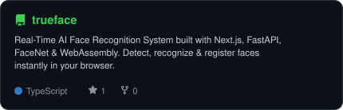
    </picture>
  </a>
</td>
<td width="50%">
  <a href="https://github.com/iamjaved026/kofitype-security-research">
    <picture>
      <source media="(prefers-color-scheme: dark)" srcset="assets/card-kofitype-security-research-dark.svg">
      <source media="(prefers-color-scheme: light)" srcset="assets/card-kofitype-security-research-light.svg">
      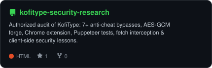
    </picture>
  </a>
</td>
</tr>
</table>

<sub>

| project | focus | stack | live / source |
|---|---|---|---|
| **[aero-chat-cli](https://github.com/iamjaved026/aero-chat-cli)** | Real-time CLI Messaging Client | `TypeScript` `Socket.IO` `JWT` | [github.com/iamjaved026/aero-chat-cli](https://github.com/iamjaved026/aero-chat-cli) |
| **[RTDB-Inspector](https://github.com/iamjaved026/RTDB-Inspector)** | Firebase Database Pentesting Suite | `TypeScript` `Firebase` `Security Audit` | [github.com/iamjaved026/RTDB-Inspector](https://github.com/iamjaved026/RTDB-Inspector) |
| **[trueface](https://github.com/iamjaved026/trueface)** | In-Browser AI Face Recognition | `FastAPI` `FaceNet` `WebAssembly` `Next.js` | [github.com/iamjaved026/trueface](https://github.com/iamjaved026/trueface) |
| **[kofitype-security-research](https://github.com/iamjaved026/kofitype-security-research)** | Anti-Cheat Bypass & AES-GCM Forge | `JavaScript` `Cryptography` `Puppeteer` | [github.com/iamjaved026/kofitype-security-research](https://github.com/iamjaved026/kofitype-security-research) |

</sub>

</div>

---

## `~/` telemetry terminal

```bash
> systemctl status javed.service
● javed.service - Javed Hussain (0xJAVED) Autonomous Agent
     Loaded: loaded (/etc/systemd/system/javed.service; enabled)
     Active: active (running) since Tue 2026-03-12 10:56:44 UTC
   Main PID: 1337 (hacker_brain)
     Memory: 64.0G (expanding knowledge graph)
        CPU: 100% (reverse engineering reality)
      Tasks: [
        [✔] Offensive Security & Threat Modeling
        [✔] Real-Time WebSocket Protocols
        [✔] Hardware Serial / UART Bus Probing
        [✔] Biometric Neural Network Inference
        [✔] Autonomous Open-Source Engineering
      ]

Status: "Zero-days hunted. Daemons spawned. Code deployed." ⚡
```

---

<div align="center">

### `~/` terminal uplink

<a href="https://iamjaved.site">
  
</a>
&nbsp;
<a href="mailto:jvdhussain2008@gmail.com">
  
</a>
&nbsp;
<a href="https://github.com/iamjaved026">
  
</a>

<br><br>

<sub>`01110011 01100101 01100011 01110101 01110010 01101001 01110100 01111001 00100000 01100010 01111001+01100100 01100101 01110011 01101001 01100111 01101110`</sub>

</div>
